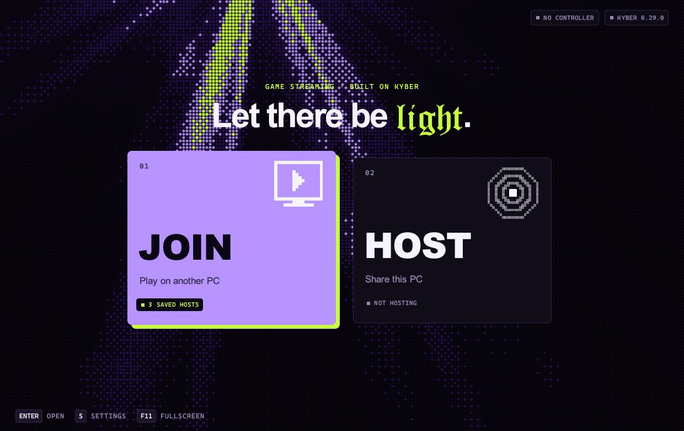
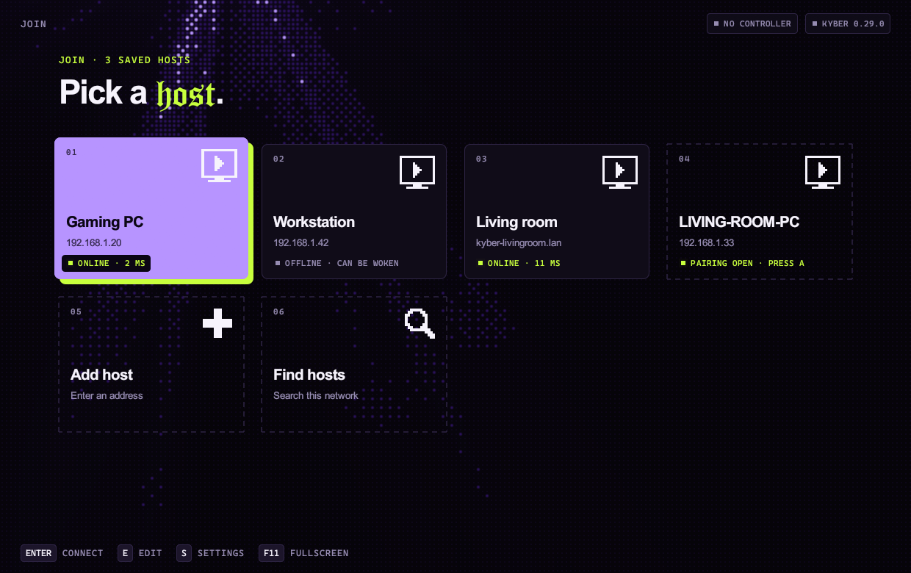
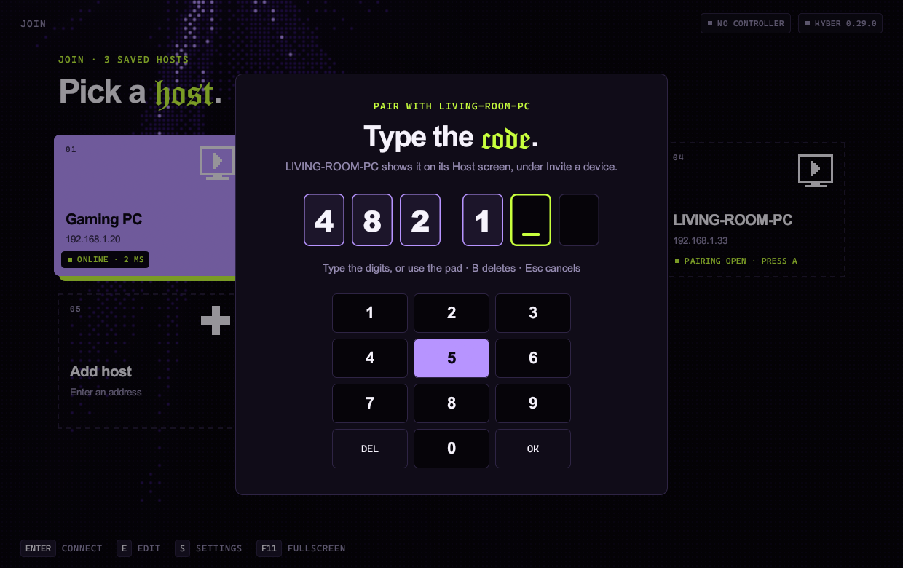
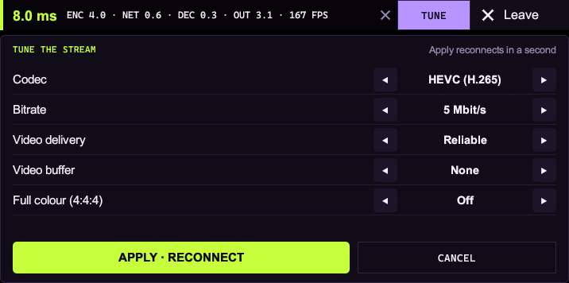
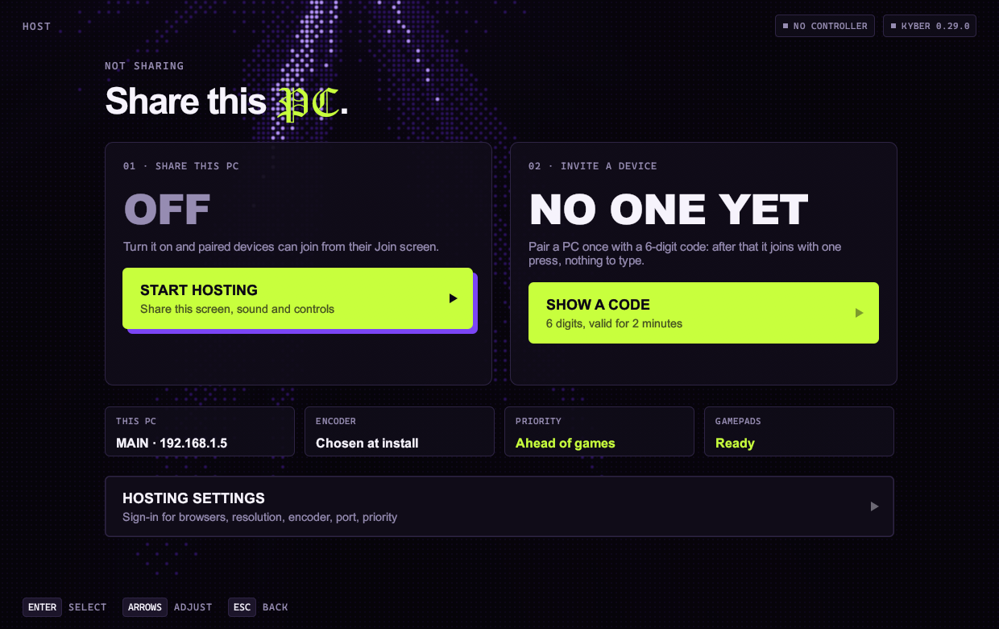
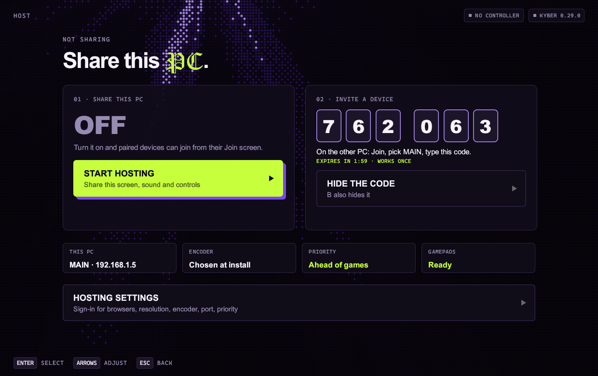
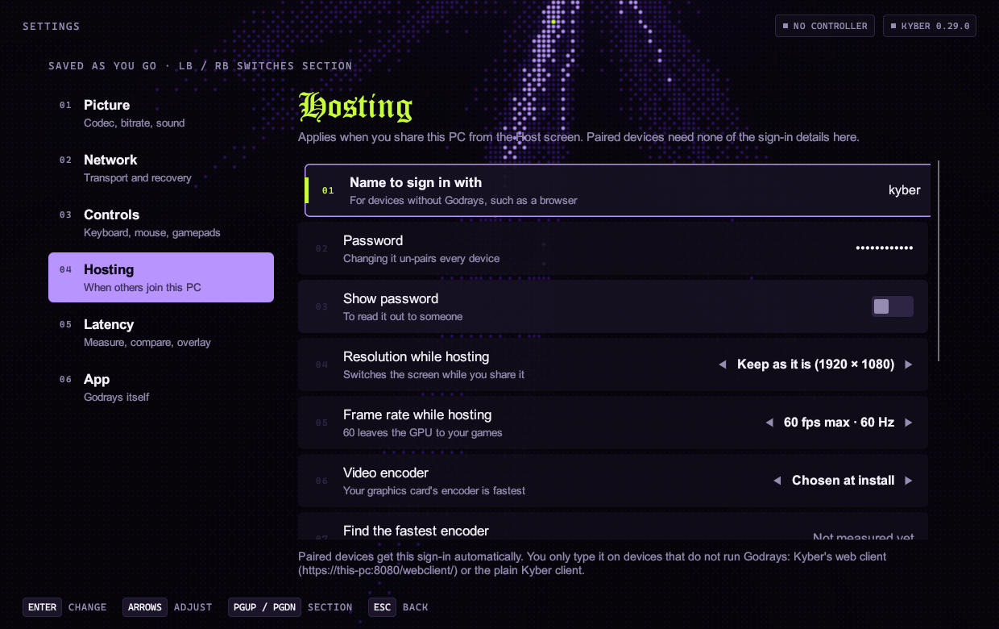
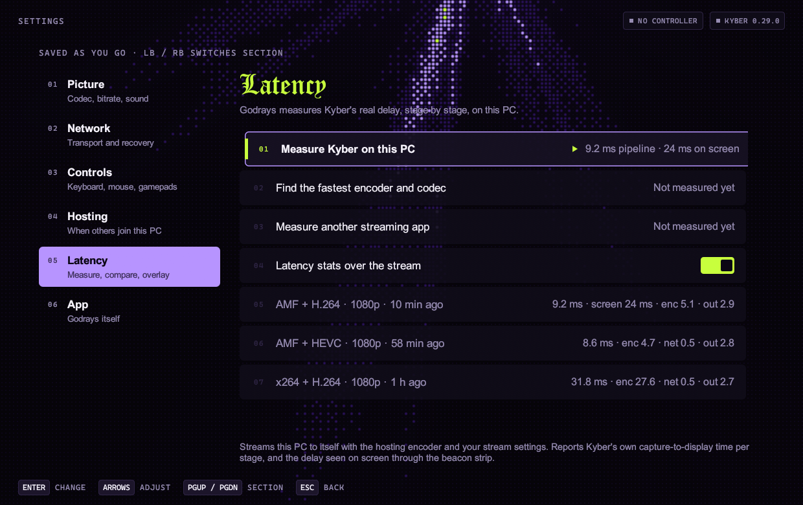
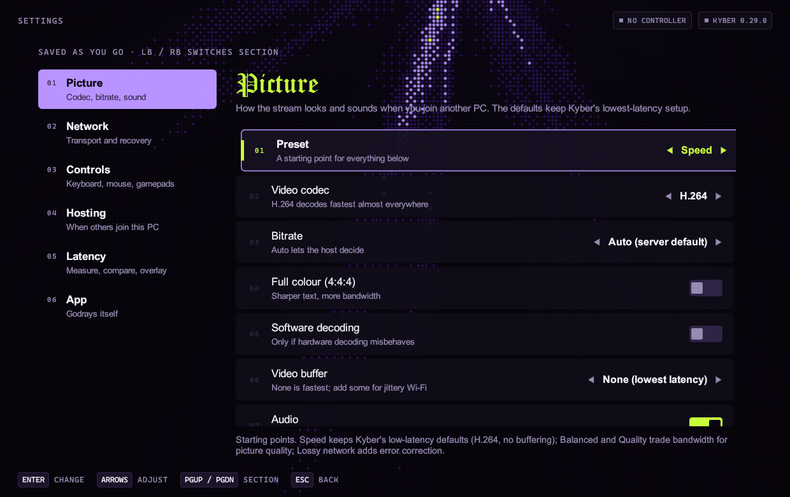

# Godrays

**[Website](https://jeanpauldot.github.io/godrays/) · [Download](https://github.com/JeanPaulDot/godrays/releases/latest)**

A couch-friendly game-streaming launcher built on [Kyber](https://gitlab.com/kyber/kyber). Open it, pick **Join** or **Host**, and drive everything with a gamepad, a keyboard or a mouse.



Kyber ships a command-line client (`kyclient`) and a server (`kycontroller`), and no launcher. Godrays installs Kyber for you, keeps your hosts and settings, and starts the client or the server with the right options. The stream itself, including gamepad forwarding, is Kyber's.

Godrays is not affiliated with the Kyber project. Where it goes next, compared with Parsec and Moonlight: [ROADMAP.md](ROADMAP.md).

## Run

A ready-made Windows build is on the [releases page](https://github.com/JeanPaulDot/godrays/releases/latest). To build it yourself (it was built with Rust 1.93):

```bash
cargo build --release
```

| Option | Effect |
|---|---|
| `--connect <HOST>` | Join a saved host (name or address) immediately |
| `--host` | Start hosting this PC immediately |
| `--setup` | Install Kyber right away if it is missing |
| `--fullscreen` | Start Godrays fullscreen |
| `--find-encoder` | Measure every encoder and codec pair on this PC, print the results and exit |
| `--lab <measure\|fastest\|other>` | Run a latency test at startup (see Latency lab) |
| `--exit-after-lab` | With `--lab`: print the results and close when the test is done |
| `--demo` | Sample hosts; saved settings are neither read nor written |

### Coming from "Kyber Launcher"

This project used to be called Kyber Launcher. On its first start, Godrays copies your saved hosts and settings from `%APPDATA%\kyber-launcher\config` and moves your saved passwords to its own entries in Windows Credential Manager. The old settings file is left where it was.

## First start: installing Kyber

If Kyber is missing, Godrays opens on a setup screen. *Install Kyber* then:

1. downloads the official Kyber 0.29.0 Windows installer (62 MB) from `gitlab.com/kyber` and compares it with a SHA-256 checksum built into Godrays; a file that does not match is discarded;
2. runs it silently, which installs the client and the server into `C:\Program Files\Kyber`. Windows asks for administrator permission once;
3. sets Kyber's Windows service to manual start, so the PC is not shared unless you start hosting yourself.

The Kyber version is pinned in `src/kyber.rs`. To move to a newer release, update the version, URL, size and checksum there. Automatic setup is Windows-only.

## Join



- **Found on your network:** a PC running Godrays that is hosting, or has pairing open, appears on its own within a second (mDNS). Select it and type the 6-digit code it shows.
- **Typing the code:** six boxes and a number pad. Type the digits on a keyboard (or paste them), or move over the pad with the d-pad and press A; B deletes. The code is checked as soon as the sixth digit is in; a wrong one shakes the boxes and clears them.



- **Pairing:** on the host, *Host > Invite a device > Show a code* shows a code that works once, for two minutes. Entering it on the other PC hands over the sign-in and pins the host's certificate, so nothing has to be typed and nothing can impersonate the host. The exchange uses SPAKE2, so the code cannot be guessed from what crosses the network, and three wrong tries burn it. An existing host can be paired from its editor (*Pair with a code*).
- **Add host:** enter the address (`host:port` is accepted). Sign-in is a name and password, a JWT, or OIDC in the browser.
- **Find hosts:** checks every address of your local /24 networks for a Kyber server on port 8080, for hosts that do not run Godrays.
- **Status:** each card shows whether the host answers and how long the TCP handshake took; paired hosts also say when they are hosting.
- **Fastest codec:** a paired host tells the client which codec measured fastest on its graphics card, and the client uses it (*Settings > Network > Use the host's fastest codec*).
- **Wake-on-LAN:** the host's MAC address is remembered the first time it is seen online. Connecting to an offline host sends a wake-up packet and starts the stream as soon as it answers.

### Leaving a stream

Any of these, at any time:

- **Ctrl + Alt + Shift + Q** on the keyboard. Godrays watches raw keyboard input, so this works even while the stream has the keyboard captured.
- **Start + Back + LB + RB**, held for one second on an XInput gamepad.
- The **Leave** button of the toolbar in the top-right corner of the screen, which stays on top of the stream.

### The toolbar over the stream

- **Live stats:** Kyber's capture-to-display time and each stage (encode, network, decode, render), with the frame rate. The **×** at its end hides it, so it stays out of the way; **Stats** brings it back, and so does **Ctrl + Alt + Shift + S**. *Settings > Latency* turns it off for good.
- **Tune:** change the codec, bitrate, video delivery, video buffer or full colour while you play, then *Apply*: the stream reconnects in about a second with the new settings, which are kept for next time. The panel shows the previous settings' numbers, so you can keep whatever measures best.
- **Leave.**

*Settings > App > Toolbar over the stream* hides Tune and Leave.



If the host stops sharing, the stream ends by itself and you are told so, instead of being left on a frozen picture.

## Host



The Host screen has two jobs, side by side:

1. **Share this PC.** *Start hosting* runs the Kyber server until you stop it or close Godrays. The panel says whether you are live, for how long, and how many players are connected.
2. **Invite a device.** *Show a code* puts a 6-digit code on screen for two minutes. On the other PC: Join, pick this PC, type the code. That device is paired for good: it joins with one press from then on.



Under them, this PC's name and address, the encoder in use, the priority and the gamepad driver at a glance. No name or password is shown: paired devices get the sign-in during pairing. It is still there for devices that do not run Godrays (Kyber's web client or plain `kyclient`), under *Hosting settings*:



- **Stopping is clean.** Godrays asks the server to shut down the same way Kyber's own Windows service does, so it disconnects every connected player and unplugs its virtual gamepads before exiting. Only if it has not finished after 4 seconds is it terminated.
- **Video encoder.** Your graphics card's encoder (NVENC, AMF, Quick Sync) is far faster than software, but it has to work with your drivers: a wrong choice gives the other side a connection with no picture. *Find the fastest encoder* streams to this same PC with every encoder and codec pair the card offers, measures each, and selects the fastest one that really shows a picture.
- Changing the hosting password, or *Un-pair all devices*, un-pairs every device.
- **Stream ahead of games** (on by default) gives Kyber's capture and encode processes REALTIME GPU scheduling priority, falling back to HIGH if Windows refuses, plus high CPU priority. With the GPU at full load it made encoding 20% faster and cut the worst-case delay by 12 ms in our measurements; HIGH alone made no difference.
- Before starting, Godrays checks that the hosting port is free for both TCP and UDP. A UDP clash used to let players connect and then wait for a picture that never came.
- Kyber's second video engine can be chosen with `engine = "libavconv"` under `[hosting]` in the settings file. It measured equal when idle and much slower under GPU load, so it is not offered in the interface.
- **Resolution and frame rate while hosting.** Kyber streams the display exactly as it is, at its refresh rate; it has no frame-rate setting of its own. So Godrays switches the main display when hosting starts, to the chosen resolution at the highest refresh rate not above the frame-rate cap (60 fps by default; 90, 120, 144 or the display's highest can be chosen), and switches it back when hosting stops. The change is never saved: if Godrays quits unexpectedly, Windows returns to your own setting.
- **60 fps or more?** Measured on this PC (streaming to itself, so both ends ran at the chosen rate): idle, 165 Hz showed the picture in 24 ms against 50 ms at 60 Hz. With the GPU at full load, 60 fps halved the encode time (6 ms against 11 ms) and the delay on screen came out about the same (50 against 47 ms). 60 fps leaves the GPU to your games; a higher rate is quicker and smoother when the GPU has room.
- The password is generated at random the first time and can be changed (at least 8 characters). It is kept in Windows Credential Manager; the server's configuration only holds its hash.
- Godrays runs the server as an ordinary program with its own configuration (`%APPDATA%\godrays\config\host\kyber_config.toml`), so starting, stopping and changing the sign-in never need administrator rights. Kyber's token sign-in is switched off there, because Kyber's template enables it with a published development key.
- For controllers, Kyber needs the [ViGEmBus driver](https://github.com/nefarius/ViGEmBus/releases) on the hosting PC. The Host screen shows whether it is installed.

Everything above lives in *Settings > Hosting*.

Per Kyber's documentation, a server that is not running as the Windows service cannot show Windows permission prompts or the lock screen to the remote side.

## Latency lab



*Settings > Latency* measures instead of guessing. Two numbers come out:

- **Pipeline:** Kyber's own timestamps for every frame, from capture on the host to display on the client, split into encode, network, decode and render.
- **On screen:** a small barcode strip (the beacon) shows the time in milliseconds at the top-left of the screen. A screenshot catches it twice, the original and its copy inside the stream window, and the difference is the delay you actually see. It adds the waits for screen capture and display refresh that the timestamps cannot see, and it works the same way for any streaming app.

| Action | What it does |
|---|---|
| Measure Kyber on this PC | Streams this PC to itself for 8 seconds with your settings; reports both numbers |
| Find the fastest encoder and codec | Measures each pair the graphics card offers and makes the fastest working one the hosting default (about 30 seconds) |
| Measure another streaming app | Shows the beacon for 20 seconds while you stream this screen with another app on this PC (for example Moonlight connected to Sunshine), for a like-for-like comparison |

Measured on a Radeon RX 5700 XT, desktop at 1920 × 1080 and 165 Hz: AMF + H.264 at 7.0–7.8 ms pipeline (encode 3.7–4.2, network 0.4, decode 0.2, render 2.8) and 24 ms on screen; software x264 at 31.8 ms. With a game stand-in holding the GPU at full load, encode rises to about 30 ms even with the priority boost; [ROADMAP.md](ROADMAP.md) has the numbers and what comes next. Results are kept in `latency-results.json`. [ROADMAP.md](ROADMAP.md) explains the targets.

## Controls

| Gamepad | Keyboard | Action |
|---|---|---|
| D-pad / left stick | Arrow keys | Move, adjust a setting |
| A | Enter / Space | Open, connect, change |
| B | Esc | Back, cancel |
| X | E / F2 | Edit the selected host |
| Y | S / F1 | Settings |
| LB / RB | PgUp / PgDn | Switch settings section |
| Start | F11 | Fullscreen |
| Start + Back + LB + RB (hold) | Ctrl + Alt + Shift + Q | Leave the stream |
| | Ctrl + Alt + Shift + S | Show or hide the live latency strip |

Text fields open an on-screen keyboard for the pad (A type, X delete, Y shift, Start done); a real keyboard types straight into the field. While a stream runs, the controller belongs to the stream and Godrays ignores it.

## Settings



Six sections on the left (Picture, Network, Controls, Hosting, Latency, App), switched with LB / RB, PgUp / PgDn or a click. Each setting has a one-line note under its name; the selected one's full explanation sits under the list.

Every stream setting maps to a `kyclient` flag; only values that differ from kyclient's defaults are passed. The stream screen shows the exact command line (password masked). Presets are starting points:

| Preset | Sets |
|---|---|
| Speed | H.264, 4:2:0, server-chosen bitrate, no buffering: Kyber's own low-latency defaults |
| Balanced | HEVC at 30 Mbit/s |
| Quality | HEVC at 80 Mbit/s with 4:4:4 colour |
| Lossy network | H.264 at 15 Mbit/s, video and audio sent unreliably with forward error correction |

## The look

The interface borrows its visual language from print: a near-black canvas, lavender and lime, halftone dot gradients, pixel-art marks, a tight bold grotesk with one blackletter word for emphasis, and small monospace capitals for labels.

- **The backdrop** is a fragment shader (`src/fx.rs`): volumetric light shafts falling from above the window, sampled on a coarse grid and reduced to four colours with an ordered Bayer dither, each cell drawn as a dot. The light leans towards whatever is selected.
- **Cards** are flat and quiet, with white pixel-art icons. The selected card turns lavender, pops forward with a slight overshoot and gets a lime offset shadow.
- **The icon** is a white pixel G on a black octagon, drawn on a 16 × 16 grid in code (`src/ui.rs`); `godrays --export-icon assets/godrays.ico` rewrites the multi-size icon that `build.rs` embeds in the .exe.
- **The website** ([docs/index.html](docs/index.html), served by GitHub Pages) runs the same light-shaft shader in WebGL2. Its light follows the hovered button or card, as the launcher's follows the selection, and wanders when nothing moves.
- **The launcher draws at most 60 frames a second** (it is a menu: the GPU belongs to games and the stream), except during a latency test, whose on-screen clock must change at every refresh.
- **Fonts** come from Windows (Arial, Arial Black, Old English Text, Cascadia Mono); none are bundled. Anything missing falls back to egui's built-in fonts.
- All motion stops while a stream runs or Godrays is in the background, so it costs nothing when it would only get in the way. Without OpenGL 3.1 the backdrop falls back to a still version.

## Where things are stored

- Settings and hosts: `%APPDATA%\godrays\config\config.toml` (override the folder with `GODRAYS_CONFIG_DIR`).
- Passwords and tokens, including the hosting password: Windows Credential Manager, under `godrays`.
- Logs: the client's in `%APPDATA%\godrays\config\client-log`, the server's in `%APPDATA%\godrays\config\host\log`. With the latency strip on, the client also writes `metrics.json` there (about 270 MB an hour); it is deleted when the stream ends.
- Latency results: `%APPDATA%\godrays\config\latency-results.json`.
- Paired devices: listed in the settings file; their secrets are in Credential Manager.

### Network ports

- **8080** TCP and UDP: Kyber, while hosting.
- **8081** TCP: the Godrays agent (pairing and status), while hosting or while a pairing code is shown.
- **5353** UDP: mDNS, to find hosts.

Windows Firewall asks the first time Godrays listens; allow it on private networks for pairing and discovery to work.

`kyclient` only accepts a password on its command line, so while a stream runs the password is visible to other programs running under your Windows account. The same is true, for the few seconds the Kyber installer runs, of the sign-in passed to it.

## Limits

- **Start streams fullscreen** presses Ctrl+Alt+F for you once video is playing, because kyclient has no fullscreen option. Windows only.
- The gamepad quit combo reads XInput controllers. Pads that Windows does not expose through XInput (for example a DualSense without Steam Input) need the keyboard shortcut or the Leave button.
- Closing Godrays ends the stream and the hosting it started.
- Developed and tested on Windows. The joining side builds around the same `kyclient` flags on Linux and macOS, but that is untested.

## Tests

```bash
cargo test
```

`examples/fake_kyclient.rs` is a stand-in for the Kyber client, server and installer, for exercising Godrays without Kyber. With it built, the process tests run too:

```bash
cargo build --example fake_kyclient
```

```bash
FAKE_KYCLIENT=target/debug/examples/fake_kyclient.exe cargo test
```

`examples/gpu_load.rs` keeps the GPU at full load, like a demanding game, to measure hosting under load:

```bash
cargo run --release --example gpu_load
```

`GPU_LOAD_DRAWS=256` splits each frame into many draws, as games do; `GPU_LOAD_ITER` sets the work per pixel. Run a lab test while it runs. `GODRAYS_GPU_PRIORITY` (0–5) overrides the GPU priority class the boost asks for.

## Licence

Godrays is MIT-licensed ([LICENSE](LICENSE)). It downloads and runs Kyber as separate programs and contains none of its code; Kyber itself is AGPLv3 or commercial.
